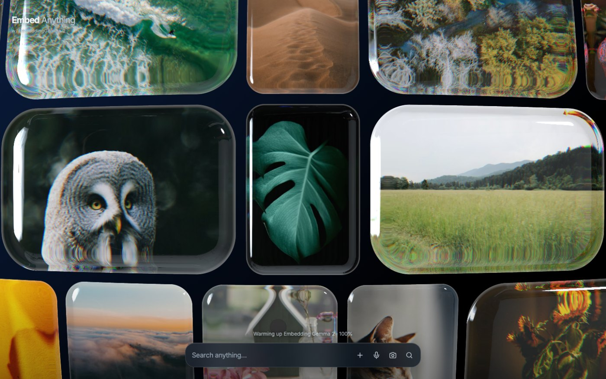
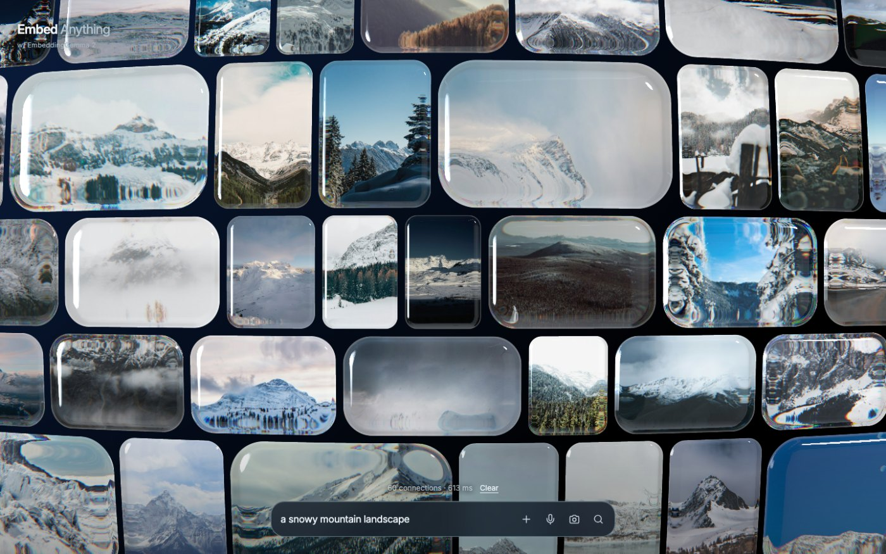
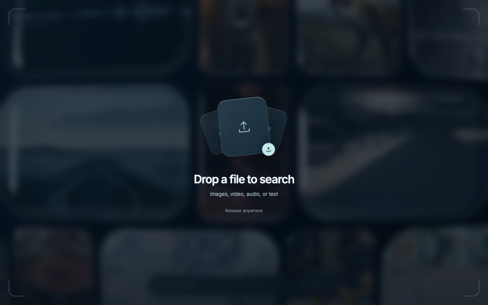
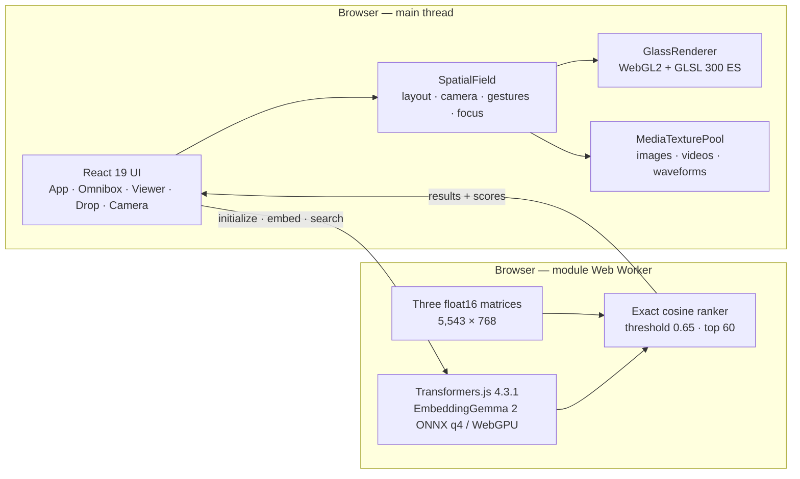
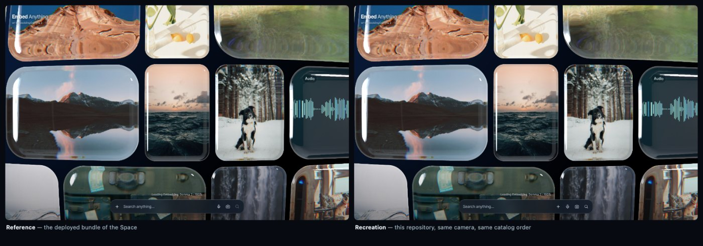

<div align="center">

# Embed Anything

### _w/ EmbeddingGemma 2_

**An almost infinite, mixed-media liquid-glass mosaic — searched with real
in-browser multimodal embeddings.**

[](https://forcewake.github.io/embed-anything/)
[](https://github.com/forcewake/embed-anything/actions/workflows/ci.yml)
[](https://github.com/forcewake/embed-anything/actions/workflows/deploy.yml)
[](LICENSE)

**[▶ Open the live demo](https://forcewake.github.io/embed-anything/)**

[Run it locally](#-quick-start) · [How it works](#-how-it-works) · [Fidelity](#-fidelity) · [Docs](#-documentation)



</div>

---

## What is this?

A faithful, **maintainable** re-implementation of the
[Hugging Face Space `webml-community/embeddinggemma-2-webgpu`](https://huggingface.co/spaces/webml-community/embeddinggemma-2-webgpu).

The original is a 2.8 MB minified bundle. This repository is the same
experience rebuilt as ~12 500 lines of typed, modular source — with the
recovered GLSL shaders kept **byte-equivalent** and the retrieval algorithm
reproduced **exactly**.

|           |                                                                   |
| --------- | ----------------------------------------------------------------- |
| **5,543** | media items — 5,000 photographs, 285 sound recordings, 258 videos |
| **768**   | embedding dimensions, all in one shared vector space              |
| **60**    | maximum hits per query, exact cosine retrieval, no ANN index      |
| **0**     | bytes of query data that leave the device                         |

### Highlights

- **Real WebGL2 glass.** Custom GLSL ES 3.00 shaders: a rounded-rectangle SDF,
  a beveled normal, a spherical curvature term, **RGB-separated refraction**
  (three different IORs), HDR environment reflections, a Schlick-style Fresnel
  and a hover lift. Instanced drawing, a `TEXTURE_2D_ARRAY` bitmap cache and a
  dedicated high-resolution texture for the focused card.
- **Real EmbeddingGemma 2.** `onnx-community/embeddinggemma-2-ONNX`, `q4`, on
  the **WebGPU** execution provider, inside a dedicated module worker. Text,
  image, audio and video queries are all supported.
- **An endless field.** 5,543 items packed into aspect-ratio aware rows and
  tiled infinitely; a spatial index keeps only the visible cards alive.
- **One floating omnibox.** Upload, text, microphone, camera and search in a
  single 560 px control.
- **Honest fallbacks.** No WebGL2 → a real CSS/DOM renderer. No WebGPU → the
  mosaic still works and the status line says the search is unavailable.

### The full loop

<table>
<tr>
<td width="50%"></td>
<td width="50%"></td>
</tr>
<tr>
<td align="center"><em>A semantic query reframes the mosaic</em></td>
<td align="center"><em>Drop a file to search</em></td>
</tr>
</table>

---

## Quick start

```bash
git clone https://github.com/<you>/embed-anything.git
cd embed-anything
npm install

npm run assets:fetch   # the three float16 matrices, the ONNX sidecar, the fonts, the HDR map (~36 MB)
npm run assets:build   # normalize the catalog into public/local/catalog.json
npm run assets:check   # verify every asset

npm run dev            # http://localhost:5173
```

> The catalog build works **without** the reference bundle: it downloads the
> public Space bundle and extracts the manifests with the TypeScript parser.
> See [`reference/README.md`](reference/README.md).

The model weights (~1 GB) are downloaded by the browser on the first search and
then served from the browser cache.

| Requirement                                              | For                  |
| -------------------------------------------------------- | -------------------- |
| Any browser with **WebGL2**                              | browsing the mosaic  |
| A browser with **WebGPU** (Chrome/Edge 113+, Safari 26+) | semantic search      |
| Node.js 20+                                              | building and testing |

`localhost` (or HTTPS) is required for the camera and the microphone.

### What is _not_ in the repository

- **`public/local/**`** — the three float16 matrices, the ONNX Runtime sidecar,
  the Inter fonts and the HDR environment map. Binary runtime assets, ~36 MB.
  Fetched with `npm run assets:fetch`.
- **`public/local/catalog.json`** — the normalized catalog, 2.9 MB. Generated
  with `npm run assets:build`.
- **`reference/embeddinggemma-recovery/**`** — the deployed bundle of the
  original Space. It has no known open-source license and is **not**
  redistributed; see [`reference/README.md`](reference/README.md).

The model weights (~1 GB) are downloaded by the browser on the first search and
then served from the browser cache.

### Commands

| Command                   | What it does                                               |
| ------------------------- | ---------------------------------------------------------- |
| `npm run dev`             | Vite dev server on :5173                                   |
| `npm run build`           | Type-check and build to `dist/`                            |
| `npm run preview`         | Serve the production build on :4173                        |
| `npm run typecheck`       | `tsc --noEmit`                                             |
| `npm test`                | Vitest unit suite (78 tests)                               |
| `npm run test:e2e`        | Playwright suite (functional + visual + a real ML search)  |
| `npm run test:e2e:update` | Re-record the visual baselines                             |
| `npm run assets:check`    | Validate the matrices, the catalog and the optional assets |
| `npm run assets:build`    | Regenerate `public/local/catalog.json`                     |
| `npm run assets:fetch`    | Download the public runtime assets                         |

---

## How it works



Two independent GPU stacks, exactly as in the reference:

- the **mosaic** is rendered with **WebGL2** and GLSL ES 3.00;
- the **model** runs through **ONNX Runtime Web on WebGPU**, in a worker.

Neither depends on the other.

### The retrieval, precisely

1. The text query is prefixed with `task: search result | query: ` — the exact
   string the reference uses, not an invented instruction.
2. Image, audio and video queries go through the model's multimodal processor:
   a Blob, mono 16 kHz PCM (≤ 60 s) and up to 32 frames of at most 720 px.
3. The 768-dimensional result is L2-normalized and compared against every one of
   the 5,543 normalized corpus vectors with an **exact dot product** — no
   approximate index, no vector database.
4. Audio rows are calibrated with `clamp((cosine - 0.08) / 0.92, -1, 1)`;
   every other row uses the raw cosine. Scores below **0.65** are discarded and
   the strongest **60** are returned, ties broken by the original catalog order.
5. The hits re-lay the mosaic into a centred spiral and frame the best results.

Clicking an already indexed card as a query re-uses its stored embedding
instead of encoding the media again.

### Project layout

```text
src/
  app/            App shell, state, drag & drop
  components/     Brand, omnibox, viewer, playback, drop overlay, camera dialog
  engine/         GlassRenderer · SpatialField · camera · layout · spatial index · media pool
  engine/shaders/ The recovered GLSL 300 ES shaders (byte-equivalent)
  media/          Catalog, audio, video, file ingestion, waveform painting
  ml/             The worker, its typed protocol, the client, fp16 and the ranker
  styles/         The chrome
docs/             Architecture, reconstruction map, feature parity, limitations
scripts/          Asset fetch/validate, the fidelity comparison harness
tests/            Vitest unit suite
playwright/       Functional, visual-regression and ML end-to-end tests
```

The mosaic is rendered by a plain class (`SpatialField`) that owns the DOM, the
WebGL state and the frame timing; React only receives coarse-grained events.
The AI lives in a module worker that owns the model, the corpus and the
ranking.

---

## Fidelity

This repository ships the tooling that was used to _prove_ the recreation
matches the original, not just to claim it.

| Check                                         | Result                                                                                                                                 |
| --------------------------------------------- | -------------------------------------------------------------------------------------------------------------------------------------- |
| The layout algorithms vs. the original bundle | identical width, height, row count, column count and item positions                                                                    |
| The render at 1440×900, zoom 1                | same cards, same ids, same screen rectangles — `maxRectDelta = 0` — 2.5 % differing pixels (a playing video frame and the status line) |
| The render at minimum zoom                    | same 201 cards, same ids, `maxRectDelta = 0` — 1.3 % differing pixels                                                                  |
| A real query, “a snowy mountain landscape”    | the **same 60 hits**, the same layout, the same glass — 804 ms vs. 798 ms for the reference                                            |



Both pages receive the same deterministic `Math.random`, so they produce the
same catalog order, the same layout and therefore the same camera — every
remaining difference is then a real difference.

```bash
node scripts/compare-layout.mjs                 # the algorithms, numerically
node scripts/compare.mjs <refUrl> <appUrl>      # the render, side by side
node scripts/pixel-diff.mjs a.png b.png         # the pixel delta
```

---

## Documentation

| Document                                                   | Contents                                                                                                                   |
| ---------------------------------------------------------- | -------------------------------------------------------------------------------------------------------------------------- |
| [`docs/ARCHITECTURE.md`](docs/ARCHITECTURE.md)             | The runtime shape, the module map, the layout, camera, renderer and retrieval pipelines, and the resource-ownership rules. |
| [`docs/RECONSTRUCTION_MAP.md`](docs/RECONSTRUCTION_MAP.md) | Every recovered symbol of the reference bundle and where it lives now — with the numerical verification.                   |
| [`docs/FEATURE-PARITY.md`](docs/FEATURE-PARITY.md)         | What is verified against the original, what is ported, and the deliberate deviations.                                      |
| [`docs/LIMITATIONS.md`](docs/LIMITATIONS.md)               | The known gaps, the environment dependencies, the licensing notes and the two bugs the comparison found.                   |

---

## Privacy

Everything runs in the browser. The model, the corpus and the media are fetched
over HTTPS; **no query, image, audio clip or video ever leaves the device**,
and there is no analytics, no tracker and no hosted inference API.

---

## Contributing

Issues and pull requests are welcome — see
[`CONTRIBUTING.md`](CONTRIBUTING.md) for the workflow, the coding conventions
and the definition of done.

---

## License

The **source code** is MIT — see [`LICENSE`](LICENSE).

The **content** is not. The catalog describes Unsplash photographs, Wikimedia
audio, Pexels videos and Pixabay audio, each under its own license; the
EmbeddingGemma 2 weights are under the Gemma terms of use. The deployed bundle
of the original Space has no known open-source license and is **not**
redistributed here — this repository is an independent re-implementation.
Review [`docs/LIMITATIONS.md`](docs/LIMITATIONS.md) before publishing anything
that serves this media.

---

<div align="center">
<sub>Built by reverse-engineering the public Space, and verified against it.</sub>
</div>
