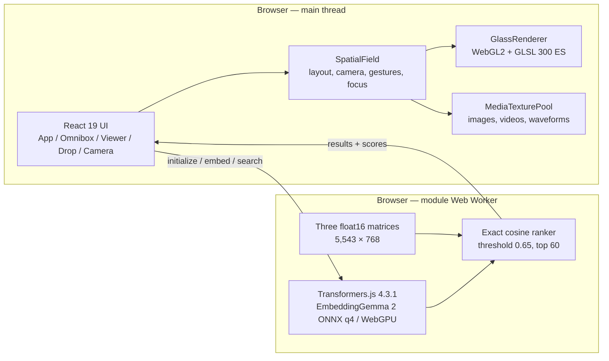

# Embed Anything — Architecture

A maintainable recreation of the Hugging Face Space
`webml-community/embeddinggemma-2-webgpu`, rebuilt from the recovered bundles
rather than copied from them.

## Runtime shape



Two independent GPU stacks, exactly as in the reference:

- the **mosaic** is rendered with **WebGL2** and GLSL ES 3.00 (custom shaders,
  instanced drawing, `TEXTURE_2D_ARRAY`);
- the **model** runs through **ONNX Runtime Web with the WebGPU** execution
  provider, inside a dedicated module worker.

Neither depends on the other: a browser without WebGPU can still browse the
mosaic, and a browser without WebGL2 falls back to a CSS/DOM renderer.

## Module map

| Module                             | Responsibility                                                            | Recovered counterpart                                                                                      |
| ---------------------------------- | ------------------------------------------------------------------------- | ---------------------------------------------------------------------------------------------------------- |
| `src/engine/GlassRenderer.ts`      | WebGL2 context, program, instance buffers, texture array, HDR environment | `Je`                                                                                                       |
| `src/engine/SpatialField.ts`       | The interactive mosaic: layout, camera, gestures, focus transition        | `Kt`                                                                                                       |
| `src/engine/CameraController.ts`   | Target/current camera, anchored zoom, inertia, orbit                      | `st`                                                                                                       |
| `src/engine/AspectMosaicLayout.ts` | Aspect-ratio aware row layout and the search-result spiral                | `ct`, `St`                                                                                                 |
| `src/engine/SpatialIndex.ts`       | Viewport query over the laid-out cards                                    | `ut`                                                                                                       |
| `src/engine/MediaTexturePool.ts`   | Bitmaps, video elements, waveform canvases, LRU cache                     | `bt`                                                                                                       |
| `src/engine/geometry.ts`           | Matrix / quaternion / sphere math                                         | `$e`, `et`, `tt`, `nt`, `rt`, `Tt`, `it`, `at`, `ot`, `Nt`, `Mt`, `Ot`, `Dt`, `kt`, `At`, `jt`, `Ht`, `wt` |
| `src/engine/shaders/glass.*.glsl`  | The vertex and fragment shaders, byte-equivalent to the reference         | `Ue`, `We`                                                                                                 |
| `src/ml/worker.ts`                 | Model lifecycle, index IO, embedding, ranking, request dispatch           | `Dj`, `Mj`, `ij`, `QA`, `Nj`                                                                               |
| `src/ml/client.ts`                 | Typed, cancellable worker client                                          | `gn`, `_n`, `vn`, `yn`                                                                                     |
| `src/ml/similarity.ts`             | Exact cosine ranking and score calibration                                | `ij`, `QA`, `tj`, `nj`                                                                                     |
| `src/ml/fp16.ts`                   | Little-endian float16 decoding                                            | `fj`                                                                                                       |
| `src/media/catalog.ts`             | Catalog normalization and row semantics                                   | `Tn`                                                                                                       |
| `src/media/audio.ts`               | Mono 16 kHz decoding, waveform reduction                                  | `on`, `mt`                                                                                                 |
| `src/media/video.ts`               | Frame extraction (≤ 32 frames, ≤ 720 px)                                  | `sn`                                                                                                       |
| `src/app/useExploreState.ts`       | App state, search lifecycle, uploads, recording                           | `kn`                                                                                                       |
| `src/components/*`                 | Brand, omnibox, viewer, playback, drop overlay, camera dialog             | `An`, `Xt`, `F`, `Zt`, `tn`, `nn`                                                                          |

## The rendering pipeline

### Layout (`ct`)

The mosaic is **not** a scatter plot and **not** a UMAP projection. The catalog
is shuffled (with a seeded PRNG, so the composition is reproducible) and packed
into aspect-ratio aware rows:

- the total width is `492 × Σ(aspect + gap/492) / rows`;
- each row is filled until the running sum of the raw aspect ratios passes half
  of the remaining-per-row target, which yields rows of varying height;
- alternate rows are staggered by half a card, and every card is wrapped into
  `[-width/2, width/2]`.

The result is a _tile_ that is repeated infinitely in both directions, which is
what makes the field feel endless.

### Camera (`st`)

A target/current pair with exponential smoothing. The camera keeps a _target_
and a _current_ view; `step()` integrates the inertia (`0.88^ratio` decay),
eases the zoom in log space, eases the position, and drives a subtle
mouse-driven orbit (pitch/yaw ≤ 0.05 rad) plus a "lean" that is proportional to
the pan velocity. The wheel zoom is anchored: the world point under the pointer
is re-projected onto the focal sphere and kept fixed.

### Renderer (`Je`)

One program, one instanced draw per frame:

| Attribute     | Location | Contents                                                       |
| ------------- | -------- | -------------------------------------------------------------- |
| `aVertex`     | 0        | subdivided quad, per-vertex                                    |
| `aRect`       | 1        | `x, y, w, h` — the card's world pose and size                  |
| `aQuaternion` | 2        | the card's orientation                                         |
| `aInfo`       | 3        | `z`, texture layer (-1 = focused texture), opacity, hover/lens |
| `aShape`      | 4        | corner radius, bevel, thickness, rim                           |
| `aSurface`    | 5        | sphere radius, image aspect, texture scale X/Y                 |
| `aDispersion` | 6        | RGB separation of the refraction                               |

The instance stride is 21 floats (84 bytes). Cards are drawn with
`drawElementsInstanced`; small cards (max side ≤ 180 px) use an 8×6 mesh, large
cards a 24×18 mesh, so the curvature is cheap where it does not matter.

The bitmaps live in a `TEXTURE_2D_ARRAY` (640×480 RGBA8, 96 layers). When more
than 95 distinct cards are visible the array shrinks to 320×240 and gains 4× the
layers; when the count drops again it goes back to full resolution. The focused
card has its own 2D texture so the viewer can show the full-resolution bitmap.

### Shaders

`glass.vert.glsl` and `glass.frag.glsl` are the **actual strings** extracted
from the reference bundle. They implement:

- a rounded-rectangle SDF and a bevel profile (`pow(1 - t^3.9, 1/3.9)`),
- a spherical "curve" term that bends the normal towards the card's edges,
- RGB-separated refraction with three different IORs (2.14 / 2.30 / 2.46),
- environment reflection from a Radiance HDR map, sampled equirectangularly,
- a Schlick-style Fresnel term, a rim light and a hover lift,
- a final gamma conversion (`pow(1/2.2)`).

The HDR environment (`studio.hdr`) is decoded with a port of the recovered
`Ge` reader (RLE scanlines, `-Y … +X …` header) and uploaded as RGBA8; the
shader re-expands it with `exp2(a * 255 - 128)`. When the file is missing the
renderer falls back to a 1×1 placeholder and the scene still renders.

## The retrieval pipeline

1. The main thread creates the worker and sends `initialize` with the asset
   base URL.
2. The worker points ONNX Runtime at the locally hosted
   `ort-wasm-simd-threaded.asyncify.{mjs,wasm}` sidecar, loads the processor
   and `onnx-community/embeddinggemma-2-ONNX` with `dtype: 'q4'` and
   `device: 'webgpu'`, and downloads the three float16 matrices in parallel.
3. The matrices are validated against their exact byte length, decoded to
   `Float32Array` and L2-normalized row by row. The combined matrix is
   `images ++ audio ++ video`, which is the row order of the catalog.
4. The model is warmed up with `task: search result | query: a photograph`.
5. A query is embedded. Text is prefixed with **`task: search result | query: `**
   (verbatim, not an invented instruction). Images go through the multimodal
   processor, audio through 16 kHz mono PCM (≤ 60 s), video through up to 32
   frames of at most 720 px.
6. The 768-dimensional result is normalized and scanned against all 5,543 rows
   with an exact dot product.
7. Audio rows are calibrated with `clamp((cosine - 0.08) / 0.92, -1, 1)`;
   every other row uses the raw cosine. Scores below **0.65** are discarded and
   the strongest **60** are returned, ties broken by catalog index.
8. The client presents the hits: the mosaic re-lays out into a centred spiral
   and frames the strongest results.

Clicking an already indexed item as a query re-uses its stored embedding
instead of encoding the media again.

## Data model

`ImageItem | AudioItem | VideoItem | TextItem | LocalItem` — a discriminated
union so a tile can never be rendered with the wrong accessor.

The canonical catalog lives in `public/local/catalog.json`, generated by
`scripts/build-catalog.mjs` from the recovered manifests. It preserves the
**stable row order** of the embedding matrices:

```text
images (rows 0 … 4999)   → local/data/embeddings.f16         5,000 × 768 × 2 B
audio  (rows 5000 … 5284) → local/data/audio-embeddings.f16    285 × 768 × 2 B
video  (rows 5285 … 5542) → local/data/video-embeddings.f16    258 × 768 × 2 B
                                                          total 8,514,048 B
```

`embeddingIndex` is the offset inside the _collection's own_ matrix; `row` is
the offset inside the combined matrix. The display order is applied afterwards
and never influences indexing.

## Performance and resource ownership

- React never re-renders per frame. The renderer owns the frame timing; React
  only receives coarse-grained state (selection, results, status).
- The spatial index culls to the viewport, so 5,543 items never become 5,543
  live DOM nodes or textures.
- The media pool caps concurrent image loads at six, keeps at most 192
  posters, and releases videos that leave the viewport.
- Video frames are updated through `requestVideoFrameCallback` at 30 fps, with
  a timer-based fallback.
- Every GPU object (buffers, textures, the VAO, the program) is deleted in
  `dispose()`; object URLs, media streams and timers are released on unmount.
- A WebGL context loss switches the field to the CSS/DOM fallback instead of
  leaving a blank canvas.
